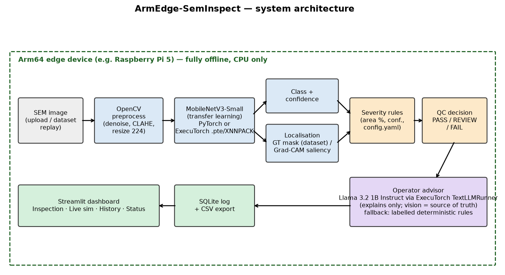

# ArmEdge-SemInspect

**On-Device AI Semiconductor Wafer Defect Detection and Quality-Control Assistant**
Bharat AI-SoC Challenge 2026–27 · Problem Statement 5 (Real-Time Industrial Defect Detection & QC Assistant) · Phase 1 prototype

PS5 applied to semiconductor wafer surface inspection on SEM images. Everything runs locally on CPU, with no cloud calls.



## What it does
| PS5 requirement | Implementation |
|---|---|
| Detect surface defects/anomalies | MobileNetV3-Small classifier (transfer learning), OpenCV preprocessing |
| Classify type & severity | Softmax class + confidence; rule-based severity LOW/MEDIUM/HIGH (area %, confidence, `config.yaml`) |
| Actionable recommendations | Llama 3.2 1B Instruct through ExecuTorch `TextLLMRunner` (explains the result and never changes it). Until the model is exported, a **clearly labelled deterministic fallback** is used |
| Log results | SQLite (`logs/inspections.db`) + CSV export |
| Local edge operation | CPU-only PyTorch **or ExecuTorch `.pte` (XNNPACK)** for the classifier; Arm64 compatible |

## Current status (honest)
- ✅ Tested on x86_64 Linux (Intel i5-13420H, CPU only). **Not yet tested on Raspberry Pi 5 / Arm64 hardware.**
- ⚠️ **The real dataset (Carinthia-S) could not be downloaded**: Zenodo returned HTTP 403 from the development network. The shipped demo therefore uses a **SYNTHETIC SEM-like dataset** (`demo_*` classes) produced by `scripts/prepare_dataset.py --demo`. The dashboard shows a "Demo mode" banner when this model is loaded.
- ✅ Vision classifier exported to and executed with **ExecuTorch 1.6** (XNNPACK). It gives the same accuracy as PyTorch eager (max logit difference 5e-6).
- ⚠️ Llama 3.2 1B: adapter implemented against the ExecuTorch Python LLM runner, but **no Llama `.pte` has been exported yet** (the weights are gated by Meta's licence). The dashboard shows "ExecuTorch model not configured" and labels every fallback text "NOT generated by Llama".

## Install
```bash
python3 -m venv .venv && source .venv/bin/activate
pip install -r requirements.txt
pip install executorch          # optional: ExecuTorch classifier backend + Llama runner
```
Note: `executorch` pins its own `torch` version. If no matching `torchvision` wheel exists, the project falls back to a built-in MobileNetV3-Small definition that is bit-identical to torchvision's. This was verified: output difference 0.0.

## Run
```bash
bash scripts/run_demo.sh        # synthetic data -> ~1 min training -> eval -> dashboard
# or, if the model is already trained:
streamlit run app.py
```
Optional ExecuTorch classifier: `python -m src.inference --export-pte` writes `models/classifier.pte`. The app then uses it automatically.

## Real dataset (Carinthia-S, CC-BY-4.0)
```bash
python scripts/download_dataset.py            # or --zip /path/to/data.zip if downloaded manually
python scripts/prepare_dataset.py             # prints discovered structure, writes data/manifest.csv
python scripts/train.py                       # ≤20 min budget, hard-capped at 30 min
python scripts/evaluate.py && python -m src.inference --export-pte
```
The archive layout was not available to verify, so `prepare_dataset.py` takes class names from the folder names and prints an inventory for you to check. See `data/README.md`.

## Arm64 / Raspberry Pi 5 deployment
1. 64-bit Raspberry Pi OS (Bookworm), Python 3.10+. `pip install -r requirements.txt executorch` (aarch64 wheels are published for torch and executorch).
2. Copy `models/mobilenetv3_small_best.pt` (and `classifier.pte`) from the training machine, or train on the device (about 1 min for the demo set).
3. `streamlit run app.py --server.address 0.0.0.0`, then open `http://<pi-ip>:8501` from the operator's terminal.
4. Optional Llama: follow `models/README.md`. Use 4-bit (8da4w) quantisation so the model fits the Pi's memory.

## Layout
`app.py` dashboard · `src/` pipeline modules · `scripts/` data/train/eval · `config/config.yaml` all thresholds · `reports/` technical report + measured metrics · `docs/` demo script + architecture · `tests/` unit tests (`pytest -q tests`).
